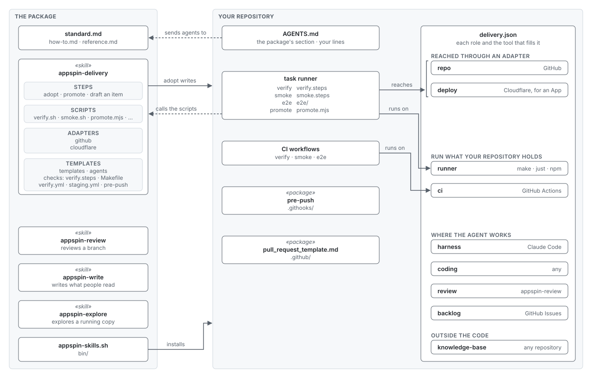
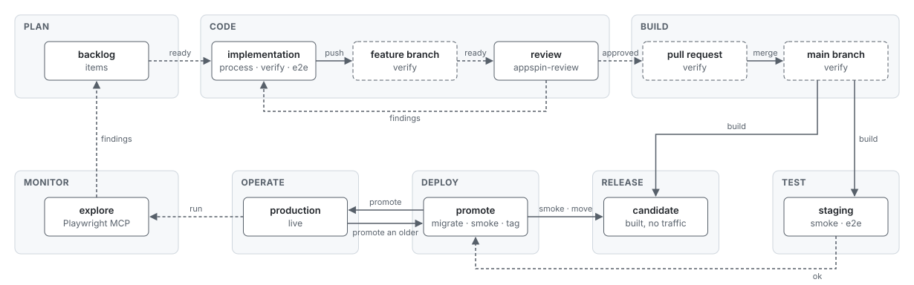

# The appspin delivery standard

The appspin delivery standard is a process for shipping software with coding
agents. It takes one change from the backlog to production: plan it, code it,
review it, test it, release it, and watch it run.

It is for you, the operator, when a coding agent writes most of your code. You
stay in charge: you read and approve every change. Agents read it too, before
they change how a project is built, reviewed, or released.

It exists because coding agents write code faster than you can review alone.
The standard divides every decision in two. What a machine checks the same way
every time is a gate, and nothing passes one by luck or by asking. What needs
someone to read and decide goes to a reviewer agent and then to you.

This page holds the rules and why they hold. The steps an agent runs are in the
[delivery skill](SKILL.md) and the [review skill](../appspin-review/SKILL.md).
Your own tasks are in the [how-to guides](how-to.md), and the tables and terms
are in the [reference](reference.md).

## The pieces

The package is this standard, an installer, and four skills: the delivery,
review, write, and explore skills. The installer puts them in your repository.
Then adopt, the delivery skill's step that sets a project up under the standard
and updates it, writes the files your repository keeps. Those files reach the
tools you choose for your project's roles, which
[Roles and adapters](#roles-and-adapters) describes.

The reference's [Files](reference.md#files) says what each piece is.

## Roles and adapters

The standard does not pick your tools. It names nine roles, such as the
repository host, the backlog, and the deploy platform. Any tool that meets a
role's contract can fill one. The `roles` key in the `delivery.json` file
records each choice. The reference's [Roles](reference.md#roles) lists the
defaults and each contract.

The package's scripts reach the repository host and the deploy platform through
an adapter, a small command that reports what a tool says and decides nothing.
The contract does not bend to fit a tool: one that cannot meet it leaves the
role unfilled. Agents reach the backlog with the backlog's own tool, such as
`gh` for GitHub Issues.

The agent's harness, the tool the agent runs in, must read the project's
instructions and ask before a dangerous action runs, as Claude Code's own
permission prompts do. Production is held another way: the agent's session has
no production credential, so production moves only when you give one to the
command that moves it.

## Two kinds of project

A project is one of two kinds, and what its production is decides which. An App
is software that runs: its production is one or more running services. Promote,
the `promote` command that moves production, moves an App's traffic to a new
build. A Software Package is installed by other projects: its production is its
highest release tag, and promote tags the new release. The deploy role records
the kind: a project with one is an App, and one without is a Software Package,
whatever the repository holds, so a monorepo is still one kind.

## The lifecycle

A change passes through the phases of the DevOps lifecycle once, from Plan to
Monitor, and what Monitor finds feeds the next Plan. Build, Release, and Deploy
follow the twelve-factor app: the code is built once, the build is combined with
its settings to make a release, and that release is what runs.

The reference's [Steps of the lifecycle](reference.md#steps-of-the-lifecycle)
walks through the diagram. What fails before the merge goes back to Code. After
the merge, promote refuses a commit with a failed check, so it never reaches
production.

## The rules

These hold in every project that adopts the standard. Each links the section,
or skill, that says the rest.

1. Every change starts as a backlog item with an outcome and acceptance
   criteria. [Plan](#plan)
2. Each item's branch is cut from the `origin/main` branch and named from the
   item; a batch shares one. [Plan](#plan)
3. Code only what is needed now. [Code](#code)
4. Decisions go in the pull request's **Design**, or an Architectural Decision
   Record (ADR) if lasting; notes go in the knowledge base. [Plan](#plan),
   [Code](#code), [Review](#review)
5. The agent deletes the tests, designs, and plans its branch wrote, except what
   the item or project keeps. [Code](#code)
6. A branch is reviewed before its pull request, which opens on your "approved".
   [Review](#review)
7. An agent running on its own stops at its branch: no pull request, merge, or
   promote. [The review skill](../appspin-review/SKILL.md)
8. The `verify` command passes before every push, on every pull request, and on
   `main`. [Build](#build)
9. After its first commit, only a pull request, merged with a merge commit,
   reaches `main`. [Build](#build)
10. Every pull request has an **Upgrade** line. [Build](#build)
11. Every merge builds, from the merged commit, never on a developer's machine.
    [Build](#build)
12. The `smoke` command never writes; the `e2e` command and an `explore` run
    write only as a test does, and delete every write on production data.
    [Test](#test)
13. A failed check is rerun only after you record its cause, never in the hope
    that it passes. [Test](#test)
14. Promote moves production only to a build of `main` whose continuous
    integration (CI) checks passed, and runs `smoke` on the candidate before the
    move and on production after. [Deploy](#deploy)
15. Going back is a promote of an older commit for an App, and a revert on
    `main` released as the next version for a Software Package; there is no
    rollback command. Going back never undoes a database migration, which is
    why each migration only adds.
    [Operate](#operate), [Database migrations](#database-migrations)
16. An `explore` run is never a gate, writes to the product only as a test may,
    and leaves its records and report in the `.explore/` folder and its block in
    the `explore log` backlog item; you decide which findings become backlog
    items. [Monitor](#monitor)
17. Enforcement code has no tests; a defect in it is fixed in the rule it
    enforces. [Questions](#questions)
18. The agent's harness asks before a dangerous action runs.
    [Roles and adapters](#roles-and-adapters)
19. Nobody edits the package's pieces, and adopt never writes the project's own
    files, except the few the delivery skill names. [Adopt](#adopt)
20. A Software Package that publishes skills follows the
    [Agent Skills specification](https://agentskills.io/specification), and
    review checks each changed skill against it.
    [The review brief](../appspin-review/references/brief.md)
21. Nothing in a repository reveals the private details of another project, a
    customer, or a person, and examples use invented names.
    [The review brief](../appspin-review/references/brief.md)
22. A document is written for its reader. An item is for the agent that builds
    it and approved by you, and a pull request is for you, before it merges on your word. A
    README is for the person who reads it later. [Plan](#plan), [Code](#code)

You are free to do anything these do not forbid. When a rule gets in the way of
a reasonable practice, the rule is too narrow. Then propose a change to the rule
rather than forcing the practice to fit.

## Plan

Agents work from written instructions, so every change starts as a backlog item,
written for the agent that builds it and approved by you.
Ideas, bugs, and `explore`'s findings go in the one backlog. Each item's branch
is cut from `origin/main`, so it carries nothing another branch has not merged.
It is named from the item, so every change links back to it. Several items can
go out together as a batch: one branch, each item in commits of its own, and one
pull request with one **Upgrade** line for them all.

Research and planning notes, apart from the design and plan a branch writes, go
in the [knowledge base](#roles-and-adapters), not the repository, and only when
you ask for them.

## Code

In Code, the agent codes the item on its branch and gets it through review. The
phase asks little of how the code is written, so that any platform, tool, and
style of code fits.

Code is a loop of coding, testing, and reviewing: the agent codes and tests in
small steps. Every branch gets [review](#review) before its pull request, and
what review finds to fix starts the loop again. Most of a change's testing
happens here, and [Test](#test) confirms it after the merge.

You and the agent agree what a change will do before the agent writes it. The
coding role's tool decides how much agreeing that takes: nothing for a typo, a
design and a plan for a new subsystem. By default it is superpowers, a set of
skills for planning and coding. The agent codes only what the change needs now:
no option, flag, or file for a need nobody has seen yet, and the agent removes
what the change makes unnecessary.

When the change adds or edits a document a person reads, such as a README or a
how-to, the agent writes it with the `appspin-write` skill.

Testing is how the agent works, not what it leaves behind. The agent writes and
runs tests as it codes. It runs the `verify` command, the checks that need no
running product. For an App, the agent runs a local copy, the product on the
agent's machine, and, where the copy has a database of its own, applies the
branch's migrations, if any, to it. It then runs the `e2e` command, the written
user flows, on that copy, and fixes what the change broke. Then it shows the
change is done the way the item's acceptance criteria say, by running it,
looking at it, or sending it a request.

A pull request is the agent's report to you, before it merges on your word. The agent
drafts its description from its
[template](assets/templates/pull-request.md). Its **Design** section says what
changes and why, and its **Seen** section says what was run or looked at and
what it showed, with any failure the change did not cause.

At the end of the branch, or of each item on a batch branch, the agent deletes
the tests, designs, and plans it wrote. It keeps a test that an acceptance
criterion asks it to keep, as [Questions](#questions) explains. A project keeps
any of them with a line of its own in the `AGENTS.md` file. Then, once every
item is done, the agent pushes the branch, and the push hook runs `verify`. The
loop ends when you say "approved" at the end of [review](#review).

## Review

Review is a [role](#roles-and-adapters), and the default tool is the
`appspin-review` skill, which holds the steps. It reads the pushed branch before
the pull request opens; on a batch branch, each item is also reviewed as it is
built, unless the project says otherwise.

Five rules hold whatever tool fills the role:

- A reviewer in a fresh context reads the branch, not the agent that wrote it.
  Where the harness cannot start one, the agent that wrote the branch reviews
  it, and the pull request's **Review** section says so. You weigh that review
  as weaker than a fresh one. The agent that wrote the branch never decides
  when review ends.
- A finding is fixed when the change fails an acceptance criterion, breaks what
  worked before, loses data, or opens a security hole, or when its fix is a cut
  to the change. Any other finding, including one about behaviour no criterion
  names, is filed or dropped with its reason. You can overturn any of them.
- You judge what a reviewer cannot: the intent, the approach, the wording, an
  App's screens, and the **Upgrade** line. Your "approved" names the branch's
  top commit, and a commit after it reopens review.
- When the approach is wrong, not only the code, the change goes back to the
  backlog or to planning. Revising the code cannot fix it.
- On a team, whoever leads it reviews each contributor's branch as its operator,
  and each branch gets its own pull request. A second person, where there is
  one, approves on the pull request before it merges.

A decision that shapes how the system is built, is costly to reverse, and
outlives its change gets an ADR in `docs/decisions/`, from its
[template](assets/templates/decision.md).

## Build

In Build, the pull request's checks pass and it merges into `main`. The merge
then builds, away from any developer's machine, so nothing from one reaches
production. The `verify` command runs three times. It runs in the push hook,
which also refuses a push to `main`. It runs on the pull request, which merges
only when it passes. And it runs on `main` after the merge.

A merge commit makes every change on `main` one merge you can find, read, or
revert. Each merge leaves `main` ready to release, its documentation included.

A Software Package's release is a [semantic version](https://semver.org/) tag,
`v<version>`, that promote names when it releases; no file holds the version.
An App has no version. A pull request's **Upgrade** line says what a project
must do to take it, including when it removes something a project might call.
The merge commit carries the pull request's description, so `git log` between
two release tags shows every **Upgrade** line in between.

## Test

Testing runs from Code to Monitor, not only in this phase. The agent tests as it
codes, checks run on every push and merge, and an `explore` run tries the
running product. The standard has four checks, each catching what the one before
it cannot, and the reference's [Commands](reference.md#commands) says where each
runs.

What tells the four apart is how each works, not what it tests, so a new check
has one home:

- `verify` needs no running copy of the product. It checks the code, and a step
  joins it only where a machine checks better than a reviewer. A test in a
  simulated page, such as jsdom, belongs here: it checks what a component does,
  never how a page looks.
- `smoke` checks that a build is up, one probe at a time. For an App, a probe is
  one read-only request, judged by its status and a string; for a Software
  Package, it is one check that a commit installs. Each probe has a control, a
  check that must fail, so a probe whose control passes too is inconclusive,
  never a pass.
- `e2e` follows a sequence of steps someone wrote: an App's few critical flows,
  which [Google](https://sre.google/workbook/implementing-slos/) calls critical
  user journeys. A check that needs a browser is an assertion in one of a flow's
  steps.
- `explore` is a sequence an agent makes up as it goes, looking for what nobody
  thought to check. It gets a place to start, not a list to sweep, since a list
  would make it an `e2e` test under another name.

The Test phase confirms after the merge what the testing in Code showed on a
local copy. Staging is the App's choice: full; partial, with some backend part
not deployed there; or none. For an App with staging, full or partial, `smoke`
and the same `e2e` flows run on staging, and promote requires their checks
either way. For a Software Package, `smoke` checks that the merge installs. A
check that passed in Code and fails here usually means the test, or the local
copy, was brittle.

When a check fails, a pass on a retry would hide the failure, so the check is
rerun only once you know why it failed. If the cause is outside both the check
and the product, such as a network outage, record it as a comment on the commit,
then rerun. A second such record for the same check means the cause is the
check's own. A cause in the check or the product is fixed on a branch. Until
that fix merges, you may skip a flaky test if you mark it with the item that
names the fix.

### Testing on production data

A test on production data, including one against the candidate, can harm real
users. `e2e` and `explore` may write there, and every test that writes meets
four criteria:

- It uses a dedicated test account with an ordinary user's role, never a real
  user's. A test of pages only one role can reach may sign in as that role;
  `explore` always uses the ordinary one.
- It touches only its own data: nothing global, and nothing a real user sees.
- It stays out of what the business counts: analytics and billing leave the test
  account out, and it sends no mail to anyone else.
- The run records every write, deletes each one by its end, and reports any it
  could not delete.

Signing in is not a test write. Apart from test writes, nothing writes to
production before promote.

## Release

Release turns a merge into a production candidate, the exact build or commit
that production can move to. Promote checks the candidate itself and then moves
production to it, so nothing changes between the check and production.

Every merge to `main` leaves a candidate. For an App, it is the merge's build.
The build's last step, an upload with the deploy platform's own command, stores
it on the platform, where it serves no traffic until promote moves production
to it. For a Software Package, the candidate is the merge commit itself, which
has no release tag yet.

## Deploy

Deploy moves production to a candidate with the `promote` command, which you run
when you decide to release.

Promote checks the commit before it moves anything. It refuses a commit that is
not on the `origin/main` branch, or whose `verify` check did not pass in CI. It
refuses one with a check that failed or is still running. It also refuses one
where a check listed in the `delivery.json` file's `ci.required` key was skipped
or is missing. For an App with staging, the staging gate's `staging-smoke` and
`staging-e2e` checks always count as listed. Promote gets each of these facts
from an adapter but makes every decision itself, so no tool can tell it that a
commit may ship. For an App, a commit a deploy tag records skips these checks:
it passed the ones that existed when it went live, and one added or renamed
since never blocks going back to it.

Promote then runs an App's database migrations on production, if the App has
any, as [Database migrations](#database-migrations) says. It runs `smoke` on
the candidate, moves production, waits until production reports the
candidate, and runs `smoke` on production. If the move or production's smoke
fails, promote stops with production where the move left it,
and prints the command that goes back, or says there is none. It never goes back
on its own. The [how-to](how-to.md#make-a-release) says what to do next.

Each release ends with a tag, the record of what went live. For an App it is a
deploy tag, written only once production's smoke passes, which also records
when. For a Software Package, the tag is the release
itself, `v<version>`, pushed before production's smoke: the last release's
minor number raised by one, or its patch number when you ask.

### Database migrations

A database migration changes the shape of an App's database, such as adding a
column. The candidate shares production's database, so promote runs the
migration on production before the candidate's `smoke`, while the live build
still serves traffic. Two rules keep that safe:

- **A migration only adds:** tables, columns, and non-unique indexes, each new
  column with a default or allowed to be empty. It renames and removes nothing,
  and adds no constraint the live build's writes could break. So the live build,
  and any older build you go back to, keep working. A removal is a later item,
  once no build you might go back to uses it.
- **A migration is a numbered file, never edited once it has run anywhere.** A
  correction is a new file. The exception is a file that cannot run again as it
  is, because it failed or a restore undid it: you change it so that it makes
  the same tables and columns. Where staging already ran the original file, it
  won't run the edited one, so review is its only check before production.

Staging's deploy runs the migration first, so staging's checks test it; an App
without staging has no such run. Promote then runs the task runner's `migrate`
command on production, from the commit it releases, unless that commit is older
than a release or than production's. If the migration fails, traffic stays
where it was, and files applied before the failed one stay. A file that
fails isn't recorded as run, so the next promote runs it again, once you have
fixed it or the data it meets. If the candidate's `smoke` fails, traffic stays
too, and what the migration added remains, harmlessly.

Going back never undoes a migration. Restoring production's database is the last
resort, for damaged data, since a restore loses every write made after its
restore point, so know how you would restore before you migrate. The
[how-to](how-to.md#migrate-a-database) has the commands for D1 and Supabase.

## Operate

Operate is production serving its users: an App's live build, or a Software
Package's highest release tag. When something goes wrong with an App, you go
back by promoting an older commit, with the same command as going forward. A
Software Package goes back by a revert on `main`, released as the next version,
since a release tag never moves. There is no rollback command. A path that runs
on every release is known to work, while a rollback command would run rarely,
untested, when it matters most.

## Monitor

Monitor finds what the checks missed and turns it into backlog items for
[Plan](#plan). It does this with `explore` runs, which you or a schedule start.
After each run, its block goes into the `explore log` backlog item, as the
explore skill describes.

You decide what happens to each finding, or an agent you set up decides for you.
A finding you want fixed becomes an item, and later runs test it again until the
item closes. A finding you reject can go unrecorded, but later runs may report
it again. To stop that, file it and close it as "won't do", which GitHub calls
"not planned". The filed item's body opens with the `Key:` line that the
[`appspin-explore` skill](../appspin-explore/SKILL.md) describes, and that skill
also says how findings are written and how long a run goes on.

Over time, runs should find less and less. If findings keep coming, things break
faster than they are fixed.

## Adopt

Adopt is how a project takes the standard, and later each update. It has two
parts. First, adopt's script writes the package's pieces exactly as they ship,
so adopt's next run loses an edit to one. Then an agent follows the
delivery skill's steps for the rest.

What adopt never writes sets its boundary: the project's code, README, docs,
scripts, checks, and any line in the `AGENTS.md` file outside the package's
section. What adopt finds about those becomes a proposal in its pull request
instead. The delivery skill names what else adopt writes, at setup and on an
update.

The project's own lines in `AGENTS.md` hold only what the code and docs cannot
say, because agents read them at the start of every task.

## Questions

**Why does the agent delete the tests it wrote?**

Agents test constantly while they work, and that stays. What goes is the pile
of tests an agent would otherwise add with every change, which grows until
nobody reads it. An item keeps a test only for an answer that could be wrong
without anyone noticing.

**Why do machines run the checks, and people make the judgments?**

A machine never forgets a check or tires of it. But a check that catches only
part of a problem makes a reviewer stop looking for the rest. So a machine gets
only the checks it does better than a person, and the judgments are yours. The
gates are `verify`, `smoke`, and promote's refusals. None of them
uses a language model, so each gives the same answer every time. The review and
explore agents only report what they find, and your "approved" decides.

**Why does enforcement code have no tests?**

Promote, `verify`, `smoke`, adopt, and the installer are enforcement
code, the code that holds the rules. Every project runs it on each change,
release, install, or update, so a defect in it shows in use. The fix goes in the
rule it enforces.

## Further reading

- [The DevOps lifecycle](https://www.ibm.com/think/topics/devops-lifecycle):
  the eight phases, with Monitor feeding Plan.
- [Twelve-factor: build, release, run](https://12factor.net/build-release-run):
  the build, release, and run stages that Build, Release, and Deploy follow.
- [Testing in production, the safe
  way](https://copyconstruct.medium.com/testing-in-production-the-safe-way-18ca102d0ef1):
  dedicated test accounts, and cleaning up what a test writes to production.
- [Who needs an architect?](https://martinfowler.com/ieeeSoftware/whoNeedsArchitect.pdf):
  architecture as the decisions that are hard to change.
- [AGENTS.md](https://agents.md/): where a project tells an agent what it
  needs to know.
- [Agent Skills: adding skills
  support](https://agentskills.io/client-implementation/adding-skills-support):
  the `.agents/skills/` directory, where the package installs its skills for any
  agent to read.
